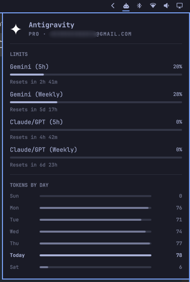

# 🚀 Omarchy Antigravity Integration

[](https://omarchy.org/)
[](https://github.com/devmercenario/omarchy-antigravity/actions/workflows/test.yml)
[](LICENSE)
[]()

Complete integration of Google Antigravity CLI (`agy`) for [Omarchy](https://omarchy.org/) Linux:
- 📊 **Real-time Quota Meters**: 5-hour session and weekly limits for the Gemini and Claude/GPT model groups, plus any per-model pool Antigravity reports (such as Gemini 4 Argon), directly in the Omarchy bar panel.
- 🚨 **Broken-Usage Alerts**: If Antigravity stops reporting a quota pool it reported during the last week (for example after an upstream format change), the bar lights up, the panel says `Usage incomplete`, and you get a single desktop notification. The bar alarm covers every agent in the panel, not only the one on screen.
- ⚡ **Agent Integration**: Antigravity can be Omarchy's default agent: the keybinding, the Omarchy menu, and the bar's agent button open `agy` (with its normal permission prompts), through a small `omarchy-agent` launcher that hands every other agent to Omarchy's own. Plus the `omarchy-antigravity` CLI helper.
- 🔔 **Status Bar Warnings**: The bar icon lights up in warning color with a tooltip when authentication is required or expired.
- 🔑 **1-Click Authentication**: Interactive **"Sign In"** button in the dashboard opens a floating terminal to log in to Google immediately.
- 🎨 **Antigravity CLI Status Bar**: Dynamic Omarchy theme-aware bottom status bar for `agy` displaying active Git branch/diff, RTK token killer status (`⚡ RTK`), Shunt-Local status (`󰘚 SL`), and balanced clock.
- 🔄 **Auto-Persistence**: Includes an `omarchy update` hook so your setup never gets wiped during system upgrades.
- 🛡️ **Zero System Pollution**: Installs entirely in user-space (`~/.local/bin`, `~/.config/omarchy/`).

---

## 📸 Overview

<p align="center">
  
</p>

When not authenticated:
- **Bar Icon**: Lights up in warning color with tooltip `"Antigravity: Waiting for auth"`.
- **Panel Banner**: Shows an alert box with a direct **[ 󰌑 Sign In ]** button that launches the Google OAuth login with 1 click.

When usage cannot be read completely (`Usage incomplete`, `Quota unavailable`, or `Collector error`), the bar lights up the same way and opening the panel jumps to the agent with the problem. A desktop notification is sent once per problem, after it shows up on two refreshes in a row so a single network blip stays quiet; the panel banner explains what is missing, without the Sign In button.

---

## 📋 Prerequisites & External Dependencies

Before installing, ensure the following dependencies are available on your system:

- **Linux Desktop Environment**: Omarchy Linux (Arch Linux + Hyprland + Quickshell).
- **[Google Antigravity CLI (`agy`)](https://antigravity.google/download#antigravity-cli)**: The official Antigravity CLI installed in your `PATH` (see [Installation & Download](https://antigravity.google/download#antigravity-cli)).
- **`libsecret` (`secret-tool`)**: Used by Antigravity and this plugin to securely read OAuth tokens from the desktop Secret Service keyring.
  ```bash
  omarchy pkg add libsecret
  ```
- **`jq`**: JSON processor used for parsing manifests and shell configs.
  ```bash
  omarchy pkg add jq
  ```
- **`python3`**: Python 3.10+ standard library runtime (pre-installed on Arch Linux).

---

## 📥 Installation

### Option 1: Quick Install (Interactive & Non-Destructive)

Clone and run the automated installer. The installer creates timestamped backups of `shell.json` and prompts before altering any existing default agent:

```bash
git clone https://github.com/devmercenario/omarchy-antigravity.git
cd omarchy-antigravity
chmod +x install.sh
./install.sh
```

**Installer Options**:
- `./install.sh --set-default`: Explicitly set Antigravity as the default agent without prompting.
- `./install.sh --no-default`: Install usage metrics and bar widget while keeping your existing default agent.
- `./install.sh -s, --statusline`: Install and configure the dynamic theme status bar for Antigravity CLI (`agy`).
- `./install.sh --yes`: Automatic non-interactive install.

### Option 2: Omarchy Plugin Manager

```bash
omarchy plugin add https://github.com/devmercenario/omarchy-antigravity.git --enable --yes
```

---

## 🛠️ CLI Management Tool

This package includes a handy `omarchy-antigravity` helper:

```bash
# Run Antigravity CLI using normal permission model
omarchy-antigravity run

# Check status, token in keyring, and live quotas
omarchy-antigravity status

# Launch interactive Google authentication
omarchy-antigravity auth

# Force refresh quota and update the bar
omarchy-antigravity refresh

# Manage Antigravity CLI status bar (status, enable, disable)
omarchy-antigravity statusline status
omarchy-antigravity statusline enable
omarchy-antigravity statusline disable
```

---

## 🔀 Dynamic Default Agent Switching

Antigravity is completely optional and non-intrusive:
- **Switch anytime**: You can change your default agent whenever you like:
  ```bash
  omarchy default agent claude   # any of Omarchy's own agents
  omarchy-antigravity default    # back to Antigravity
  ```
  Omarchy's `omarchy default agent` only accepts its built-in agents, so Antigravity is set with `omarchy-antigravity default` (or `./install.sh --set-default`). Note that `gemini` is Omarchy's Gemini CLI, not Antigravity: a `gemini` default left by older releases of this plugin is moved to `antigravity` on install and on `omarchy update`. From Omarchy 4.5 on, `omarchy default agent antigravity` works natively and saves `agy`; the panel recognizes it, and Omarchy's own launcher opens `agy` (in its unattended mode, `--dangerously-skip-permissions`) instead of the plugin's launcher.
- **Real-Time Bar Sync**: The status bar panel automatically watches `~/.config/omarchy/defaults/agent`. When you switch default agents, the bar icon and panel immediately switch their active target to reflect your chosen agent without restarting the shell.
- **Update Safety**: System updates via `omarchy update` will **never** overwrite your chosen default agent back to Antigravity if you have switched to another provider.

---

## ⚙️ How It Works Under the Hood

1. **Dual-Source Credential & Quota Extraction**:
   The collector [`omarchy-agent-usage-antigravity`](bin/omarchy-agent-usage-antigravity) securely resolves Google Cloud Code credentials by checking `~/.gemini/antigravity-cli/antigravity-oauth-token` first, falling back to the system keyring via `secret-tool`. agy's credentials are only ever read: when its access token is stale, the collector mints its own and keeps it in a private cache. Quota comes from Google's internal Cloud Code endpoint, which is fast but stopped reporting the Gemini pools; the pools it leaves out are filled in from the official CLI's structured `agy -p /usage --output-format json` output. Every `agy -p` call starts your MCP servers, so that answer is cached for 10 minutes. If a pool reported during the last week goes missing, the record is marked `Usage incomplete` so a format change is never silent, and the plan label comes from your account (for example `Google AI Pro`). Local prompt metrics and active session counts are parsed from `~/.gemini/antigravity-cli/history.jsonl` and `brain/`.
2. **Session-Aware Refresh & Low-Latency Cache**:
   To eliminate unnecessary network requests and idle disk writes, the collector inspects the OS process table (`pgrep -x agy`) and only queries remote servers when at least one active Antigravity session is running (or when `--force` is requested via manual refresh). While active, the bar refreshes Antigravity's limits every 2 minutes (`limitsRefreshIntervalSec`, default 120) and runs the full scan of every agent every 15 minutes (`refreshIntervalSec`, default 900), both configurable in `shell.json`; opening the panel also refreshes limits. The collector caches limits for 60 seconds and agy's `/usage` answer for 10 minutes, and every run finishes within a 50-second budget.
3. **Dedicated CLI & Standard Permission Model**:
   Ships a plugin-specific `omarchy-antigravity` executable in `~/.local/bin/` providing `run`, `auth`, `status`, `refresh`, `default`, and `statusline` subcommands. Executes `agy` using its standard permission model without bypassing permission prompts.
4. **Bar Widget & Status Alerts**:
   Integrates into the Quickshell bar. When quota is low, authentication is missing, or usage could not be read completely, the bar button triggers an urgent visual alert for any agent in the panel, and a new problem also raises one desktop notification via `notify-send`. A spent window clears at its reset time, even while the panel is closed.
5. **Update Hook**:
   Drops `90-antigravity.hook` into `~/.config/omarchy/hooks/post-update.d/` so every time you run `omarchy update`, your default agent and widgets remain active.

---

## 🧪 Testing

The repository comes with a 100% covered automated test suite testing the collector, installer, uninstaller, CLI, update hook, and Omarchy plugin manifest:

```bash
# Run full test suite
./tests/run_tests.sh

# Or run Python unit & integration tests individually
python3 -m unittest tests/test_collector.py
```

---

## 🛡️ Pre-push checks (marketplace review, locally)

Reproduce the Omarchy plugin marketplace's review checks against your local
commit — no push and no network required:

```bash
./tests/preflight.sh
```

Runs, in order: `omarchy plugin validate` (manifest / "Quattro" compatibility),
`qmllint` on the QML sources, the full test suite, and the marketplace's
**Automated Security Baseline** — the same deterministic scanner the
marketplace runs, executed against the local git tree via a vendored copy
(`tests/marketplace-baseline/`).

The baseline scans `HEAD` (the last commit), so commit your changes first. It
prints the same report a maintainer sees and exits non-zero when the outcome
is `needs-fixes`. To run it automatically on every `git push`:

```bash
git config core.hooksPath .githooks
```

---

## 🗑️ Uninstallation

### If installed via `install.sh`:
```bash
./uninstall.sh
omarchy restart shell
```
The uninstaller removes all installed binaries, hooks, and cache files, and restores your previous default agent backup if one was present. It only removes what is recognizably the plugin's: your own Antigravity status line and `statusLine` setting are left alone, and the agents plugin folder is removed only if the installer created it.

### If installed via Omarchy Plugin Manager:
```bash
omarchy plugin remove devmercenario.antigravity --yes
omarchy restart shell
```

### Resetting Default Agent:
You can manually change or revert your default Omarchy agent at any time with:
```bash
omarchy default agent <name>   # e.g. claude, copilot, opencode
```

---

## 📄 License

MIT License © 2026 [devmercenario](https://github.com/devmercenario)
